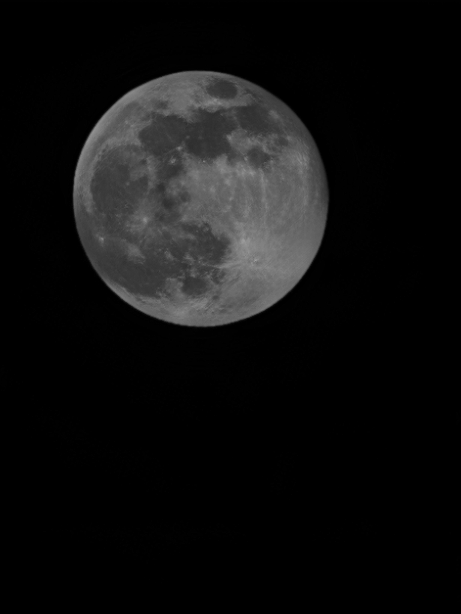

# 24300980042-陈家龙-hw3
## 题目一

### 算法设计

图像边界采用镜像填充（`np.pad(..., mode="reflect")`），输出与原图同尺寸。

**（1）平滑**

均值滤波取 $w(i,j)=\dfrac{1}{k^2}$（$k=15$），即用 $15\times15$ 邻域的平均灰度替代中心像素。高斯滤波取

$$
w(i,j)=\dfrac{1}{2\pi\sigma^2}\exp\!\left(-\dfrac{(i-r)^2+(j-r)^2}{2\sigma^2}\right),\qquad k=31,\ \sigma=5,
$$

再归一化使核元素之和为 1。

**（2）锐化**

拉普拉斯锐化取 $\nabla^2 f$ 的四邻域核

$$
w=\begin{bmatrix}0&1&0\\1&-4&1\\0&1&0\end{bmatrix},
\qquad g=f-\alpha\nabla^2f,\quad \alpha=1.
$$

非锐化掩蔽（Unsharp Masking）先以高斯滤波得到模糊图 $\bar f$，再叠加高频掩蔽 $f-\bar f$：

$$
g=f+\alpha\,(f-\bar f),\qquad \alpha=2,
$$

其中高斯核取 $k=31,\ \sigma=5$。

完整代码见 [p1.py](p1.py)。

### 数据与实验结果

测试图像为 [input.jpg](images/input.jpg)，转灰度后尺寸 $3072\times4096$，保存为 [input_greyscale.png](images/input_greyscale.png)。各算法结果如下。

原图（灰度）：

均值平滑（$15\times15$）与高斯平滑（$31\times31,\ \sigma=5$）：

|  |  |
|---|---|

拉普拉斯锐化（$\alpha=1$）与非锐化掩蔽（$31\times31,\ \sigma=5,\ \alpha=2$）：

|  |  |
|---|---|

## 题目二
### （1）
记冲击窜为 
$$ s(x)=\sum_{n=-\infty}^{+\infty}\delta(x-nT) $$
则

$$
\begin{aligned}
F(u)&=\int_{-\infty}^{+\infty}s(t)e^{-i2\pi ut}dt \\
&= \int_{-\infty}^{+\infty}e^{-i2\pi ut}\sum_{n=-\infty}^{+\infty}\delta(t-nT)dt\\
&= \sum_{n=-\infty}^{+\infty}\int_{-\infty}^{+\infty}e^{-i2\pi ut}\delta(t-nT)dt\\
&=\sum_{n=-\infty}^{+\infty}e^{-i2\pi unT}\\
&=\sum_{k=-\infty}^{+\infty}\delta(Tu-k)\\
&=\frac 1 T \sum_{k=-\infty}^{+\infty}\delta(u-\frac k T)\\
\end{aligned}
$$
证毕。

### （2）
对于离散函数 $f(n)\in\mathbb{R}, n=0, 1, \dots, N-1$，有
$$
F(k)=\sum_{n=0}^{N-1}f(n)e^{-i2\pi k n/N}
$$
所以

$$
\begin{aligned}
\overline{F(k)}&=\overline{\sum_{n=0}^{N-1}f(n)e^{-i2\pi k n/N}}\\
&=\sum_{n=0}^{N-1}\overline{f(n)}e^{i2\pi k n/N}\\ 
&=\sum_{n=0}^{N-1}f(n)e^{i2\pi k n/N}\\
&=\sum_{n=0}^{N-1}f(n)e^{-i2\pi (N-k) n/N}\\
&=F(N-k)\\
&=F(-k)
\end{aligned}
$$
证毕。

### （3）

记 $f[x,y]$、$g[x,y]$ 为大小均为 $M\times N$ 的二维离散信号。

有二维循环卷积：

$$ h[x,y]=\sum_{a=0}^{M-1}\sum_{b=0}^{N-1} f[a,b]g[x-a,y-b]. $$

其中

$$ g[x+M,y]=g[x,y],\quad g[x,y+N]=g[x,y]. $$

对卷积做傅里叶变换：

$$ 
\begin{align*}
H[u,v]&=\sum_{x=0}^{M-1}\sum_{y=0}^{N-1} h[x,y]e^{-i2\pi(\frac{ux}{M}+\frac{vy}{N})}\\

&=\sum_{a=0}^{M-1}\sum_{b=0}^{N-1}f[a,b]\cdot\sum_{x=0}^{M-1}\sum_{y=0}^{N-1} g[x-a,y-b]e^{-i2\pi(\frac{ux}{M}+\frac{vy}{N})}\\
&=\sum_{a=0}^{M-1}\sum_{b=0}^{N-1} f[a,b]e^{-i2\pi(\frac{ua}{M}+\frac{vb}{N})}\cdot\sum_{r=-a}^{M-1-a}\sum_{s=-b}^{N-1-b} g[r,s]e^{-i2\pi(\frac{ur}{M}+\frac{vs}{N})}\\
&=G[u,v]\sum_{a=0}^{M-1}\sum_{b=0}^{N-1} f[a,b]e^{-i2\pi(\frac{ua}{M}+\frac{vb}{N})}\\
&=F[u,v]G[u,v]
\end{align*} 
$$
证毕。
