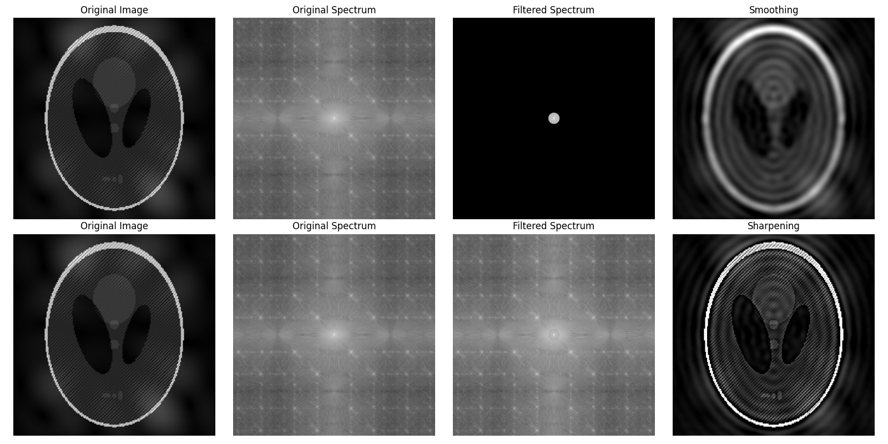
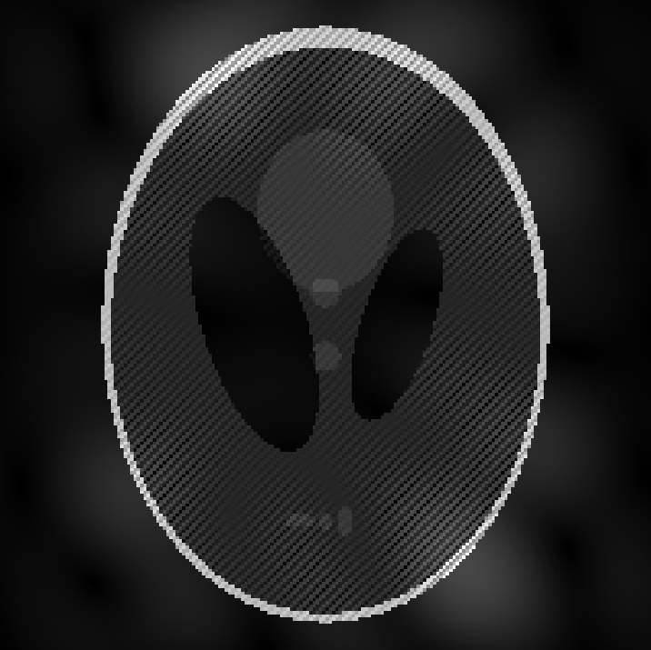

# 图像处理第四次作业报告


## HW4-1 频率域平滑与锐化

### 实现方法

首先读取灰度图，将其补零至原来的两倍宽高；随后进行二维傅里叶变换，把零频分量移动到频谱中心。滤波器与频谱相乘后，进行逆变换，并裁剪回原图大小。相关代码位于 `p1.py`。

```python
def fourier_transform(img):
    return np.fft.fftshift(np.fft.fft2(img))

def inverse_fourier_transform(img):
    return np.fft.ifft2(np.fft.ifftshift(img)).real

h, w = img.shape
padded = np.zeros((2 * h, 2 * w), dtype=np.float64)
padded[:h, :w] = img
img_freq = fourier_transform(padded)
```

平滑采用理想低通滤波器：只保留距离频谱中心小于截止半径的频率分量，其余置零。本次取截止半径 `threshold=40`。

```python
def low_frequency_filter(img_freq, threshold):
    h, w = img_freq.shape
    img_filtered = np.zeros_like(img_freq)
    for i in range(h):
        for j in range(w):
            if np.sqrt((i - h//2)**2 + (j - w//2)**2) < threshold:
                img_filtered[i, j] = img_freq[i, j]
    return img_filtered
```

锐化则保留低频，并增强高频。这里同样以半径 40 为界，将圆外的频率分量乘以 `1+k`，其中 `k=1.5`，即增强到原来的 2.5 倍。

```python
def sharpen_filter(img_freq, threshold=40, k=1.5):
    h, w = img_freq.shape
    img_filtered = np.zeros_like(img_freq)
    for i in range(h):
        for j in range(w):
            distance = np.sqrt((i - h//2)**2 + (j - w//2)**2)
            if distance < threshold:
                img_filtered[i, j] = img_freq[i, j]
            else:
                img_filtered[i, j] = (1 + k) * img_freq[i, j]
    return img_filtered
```

对于两种滤波，只需分别计算 `filtered_freq = low_frequency_filter(img_freq, 40)` 或 `filtered_freq = sharpen_filter(img_freq, 40)`，再进行逆变换并裁剪：

```python
result = inverse_fourier_transform(filtered_freq)[:h, :w]
```

### 实验结果

使用 `np.log1p(np.abs(img_freq))` 显示频谱。下图上排依次为原图、原始频谱、低通后频谱及平滑结果；下排依次为原图、原始频谱、锐化后频谱及锐化结果。



低通处理后，高频细节减少，图像变得模糊，边缘附近出现了较明显的振铃。锐化增强了轮廓，但也会放大原图中已有的周期性条纹。

## HW4-2 选择性频率滤波去除条纹

### 噪声频率检测

周期噪声在频谱上表现为远离中心、成对对称的亮点，因此可以只对这些特定频率进行衰减，而不必去除所有高频。



在 `find_noise_peaks.py` 中，首先计算对数幅度谱，再减去高斯模糊后的背景，以突出局部异常亮点。排除中心及坐标轴附近的频率后，通过局部极大值检测得到噪声频率坐标：

```python
S = np.log1p(np.abs(F))
contrast = S - gaussian_filter(S, 6)

contrast[(y-cy)**2 + (x-cx)**2 < 25**2] = -np.inf
contrast[(abs(y-cy) < 3) | (abs(x-cx) < 3)] = -np.inf

peaks = np.argwhere(
    (contrast == maximum_filter(contrast, size=9))
    & (contrast > 2.6)
)
points = [(int(i-cy), int(j-cx))
          for i, j in peaks if i > cy or (i == cy and j > cx)]
```

检测到的 21 个点以相对于频谱中心的偏移坐标保存于 `points.txt`。由于实值图像的频谱具有共轭对称性，滤波时需要同时处理每个点及其中心对称点。

### 高斯陷波滤波

在 `p2.py` 中，为每一对噪声频率构造高斯陷波器。在噪声点附近，滤波器值接近零；远离噪声点时，滤波器值接近一。将各陷波器相乘，便可同时抑制多组周期噪声。本次取 `sigma=10`。代码中将距离换算为频域上的周期最短距离，以正确处理靠近频谱边界的噪声点。

```python
def notch_filter(img_freq, points, sigma=10):
    h, w = img_freq.shape
    cy, cx = h // 2, w // 2
    y, x = np.ogrid[:h, :w]
    mask = np.ones((h, w))
    for dy, dx in points:
        for sign in [-1, 1]:
            py = cy + sign * dy
            px = cx + sign * dx
            distance_y = np.abs(y - py)
            distance_x = np.abs(x - px)
            distance_y = np.minimum(distance_y, h - distance_y)
            distance_x = np.minimum(distance_x, w - distance_x)
            D2 = distance_y**2 + distance_x**2
            mask *= 1 - np.exp(-D2 / (2 * sigma**2))
    return img_freq * mask, mask
```

读取 `points.txt` 后，对原图直接做傅里叶变换，应用滤波器并逆变换：

```python
with open('points.txt', 'r') as f:
    points = ast.literal_eval(f.read())

img_freq = fourier_transform(img)
filtered_freq, mask = notch_filter(img_freq, points, sigma=10)
result = inverse_fourier_transform(filtered_freq)
```

### 实验结果

去噪结果如下。相比原图，规律性的密集条纹明显减弱，同时尽量保留其他图像信息。


完整代码见 [p1.py](p1.py)、[find_noise_peaks.py](find_noise_peaks.py) 和 [p2.py](p2.py)。
