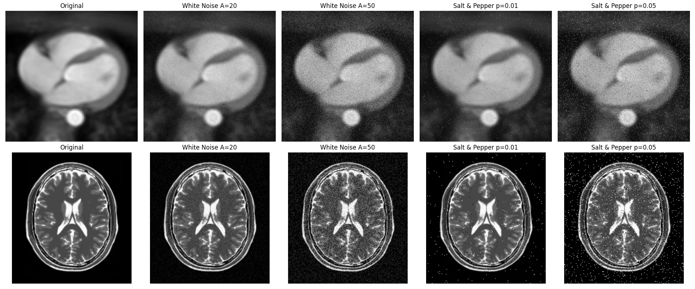
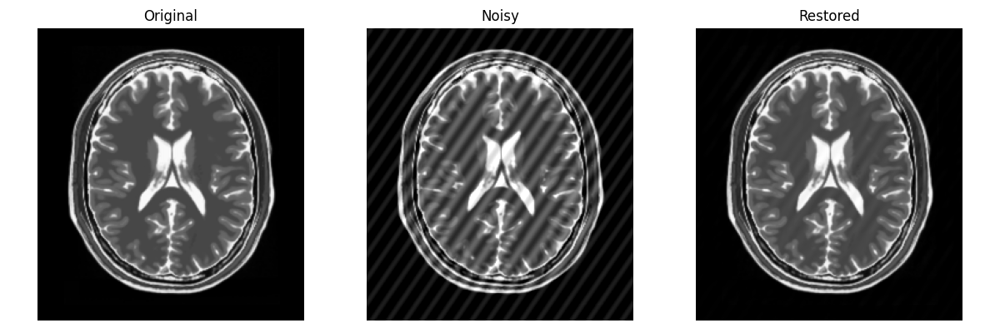

# 图像处理 HW5 报告

## HW5-1 噪声生成

均匀白噪声在各像素处独立采样，满足

$$
\eta(x,y)\sim U(-A,A),\qquad
g(x,y)=\operatorname{clip}\big(f(x,y)+\eta(x,y),0,255\big).
$$

实验分别取 $A=20$ 和 $A=50$，核心代码如下：

```python
noise = np.random.uniform(-A, A, (h, w))
noisy_img = np.clip(img + noise, 0, 255)
```

椒盐噪声以概率 $p/2$ 将像素置为黑色，以概率 $p/2$ 置为白色，其余保持不变：

$$
g(x,y)=
\begin{cases}
0,&\text{概率 }p/2,\\
255,&\text{概率 }p/2,\\
f(x,y),&\text{概率 }1-p.
\end{cases}
$$

实验分别取 $p=0.01$ 和 $p=0.05$ ,逐像素生成随机数并修改像素：

```python
r = np.random.rand()
if r < p / 2:
    noisy_img[i, j] = 0
elif r < p:
    noisy_img[i, j] = 255
```



图1中，均匀白噪声表现为遍布图像的灰度扰动，椒盐噪声表现为随机出现的黑白像素点。

源代码：[p1.py](p1.py)。

## HW5-2 最佳陷波滤波

首先在大脑图像中加入振幅为 $30$ 的周期噪声：

$$
g(x,y)=f(x,y)+30\sin\left[2\pi\left(\frac{k_xx}{W}+\frac{k_yy}{H}\right)\right],
$$

其中

$$
k_x=\operatorname{round}(W/14),\qquad
k_y=\operatorname{round}(H/20).
$$

周期噪声在中心化频谱中形成一对对称峰值。使用半径为 $1$ 的陷波带通掩模 $H_{\mathrm{NP}}$ 保留两处峰值，从而估计噪声：

$$
\hat\eta(x,y)=\mathcal F^{-1}\left\{H_{\mathrm{NP}}(u,v)\,G(u,v)\right\}.
$$

在每个 $61\times61$ 的局部窗口 $S_{xy}$ 内，计算最优权重

$$
w(x,y)=\frac{\operatorname{Cov}_{S_{xy}}(g,\hat\eta)}
{\operatorname{Var}_{S_{xy}}(\hat\eta)},
$$

然后从污染图像中减去加权估计噪声：

$$
\hat f(x,y)=g(x,y)-w(x,y)\hat\eta(x,y).
$$

这一权重通过最小化复原结果的局部方差得到。核心处理流程为：

```python
spectrum = np.fft.fftshift(np.fft.fft2(noisy_image))
H_np = notch_pass_filter(noisy_image.shape, fx, fy)

noise_spectrum = H_np * spectrum
estimated_noise = np.fft.ifft2(
    np.fft.ifftshift(noise_spectrum)
).real

weights = optimal_weights(noisy_image, estimated_noise)
restored_image = np.clip(
    noisy_image - weights * estimated_noise, 0, 255
)
```



由图2可见，最佳陷波滤波有效抑制了周期性条纹，同时较好地保留了原图像的结构。

源代码：[p2.py](p2.py)。